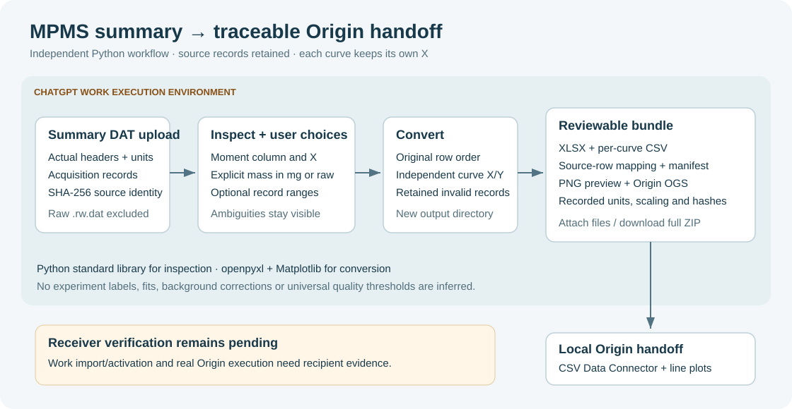

# MPMS summary data → Origin

[中文](README.md) · MIT · v0.1.2

An open-source skill for **ChatGPT Work cloud execution**. It turns uploaded Quantum Design MPMS **summary DAT** tables into XLSX, per-curve CSV, source-row mappings, a manifest, a PNG preview and an Origin OGS import/plot handoff. It discovers actual headers and units before applying the user's chosen moment column, X, mass and segment ranges.

**v0.1.2 exports selected ranges with full-source traceability.** See the [verification record](skills/mpms-summary-to-origin/references/verification.md) for tested environments.



## Data decisions

- Require the user's explicit sample mass **in mg**, or their explicit choice of `raw` unnormalized moment. Normalization is `moment_emu / (mass_mg / 1000)`, in emu/g.
- Inspect actual headers, units, finite counts and candidate ambiguity. Select the moment column explicitly; no DC generation has a universal priority.
- Retain acquisition order, repeated points and **each curve's own X**. Explicit source-record ranges can override segmentation. Experiment identities such as ZFC/FC or hysteresis branches are not inferred.
- Retain missing/nonfinite records in provenance, with unavailable numeric cells blank. Original tokens are preserved. Raw voltage scans **`.rw.dat` are unsupported**.
- No fitting, background subtraction or arbitrary quality rejection is applied. Experimental interpretation requires the measurement protocol.

## Use in ChatGPT Work

Distribute this repository with `plugin.json` and `skills/` at the plugin root. It follows the public **Agent Plugins 1.0** layout and declares no local Origin connection. Use the recipient's available plugin import/install surface and confirm skill discovery in a fresh Work chat. Host import and public-directory publishing are separate processes; uploading a ZIP alone does not establish installation. See the [public sources](skills/mpms-summary-to-origin/references/sources.md).

If plugin import is unavailable, upload/extract the reviewed source and run it manually. Record this as **manual source use**, not installation or activation. The skill folder carries its own dependency file, scripts, references and `delivery.json` allowlist for standalone extraction.

Suggested prompt:

> Use mpms-summary-to-origin to inspect my uploaded MPMS summary DAT. Show actual moment candidates, units and segmentation ambiguity before conversion. I will confirm the moment column, X and sample mass in mg or raw mode. Deliver XLSX, curve CSVs, provenance, manifest, preview and the complete Origin OGS handoff bundle.

## Manual source use

Python **3.10+** is required. Inspection uses only the standard library. Conversion needs **openpyxl >=3.1,<4** and **Matplotlib >=3.8,<4** in the execution environment; a recipient's local installation cannot satisfy a cloud dependency.

```sh
python -m pip install -r requirements.txt
python skills/mpms-summary-to-origin/scripts/mpms.py inspect /path/to/upload.dat --output /path/to/inspection.json
```

Replace the placeholders using inspection results and the user's explicit mass:

```sh
python skills/mpms-summary-to-origin/scripts/mpms.py convert /path/to/upload.dat --output /path/to/new-output --moment-column 'ACTUAL HEADER' --x temperature --mass-mg USER_MASS_MG
```

Replace the mass option with `--raw` for unnormalized moment. Use `--x field` for field, or `--x-column` for an explicit X header/index. Override ranges with `--segments /path/to/confirmed-segments.json`, starting from the inspection's `segment_template` and preserving full source-record coverage. Output must be a new directory. With only the skill folder extracted, run `python scripts/mpms.py ...` from that folder and use its own requirements file.

For target curves, use `--target-range START END` with inclusive source record numbers. Repeat it in source order for multiple curves. Rows outside those ranges remain in the workbook's source sheet and the source mapping CSV.

Read the [English workflow](skills/mpms-summary-to-origin/references/en/workflow.md) and [format/scientific decisions](skills/mpms-summary-to-origin/references/en/format-and-decisions.md) for details.

## Deliverables and receiver checks

| Artifact | Purpose |
| --- | --- |
| `magnetometry.xlsx` | Metadata, original fields, curve index, per-curve sheets and independent XY wide table |
| `curve_*.csv` | Each curve's numeric values and source-record/physical-line references |
| `source_rows.csv`, `manifest.json` | Full mapping, source SHA-256, settings/scaling/ranges and artifact hashes |
| `preview.png` | Matplotlib preview for order and units |
| `import_origin.ogs` | Local CSV import and line graph per curve in Origin |

Extract the complete output bundle and run its OGS `Main` section with the Windows directory argument, including the final backslash. It uses Origin's CSV Data Connector; verify numbers, missing-point behavior and graphs in the actual recipient's Origin version. The PNG is a preview, not an Origin screenshot. Native `.opju` generation is outside this package.

The [receiver procedure](skills/mpms-summary-to-origin/references/receiver-checklist.md) records Work installation/manual execution separately from Origin execution. The repository distributes no uploaded data, example DAT, test answers or generated exports. Synthetic verification materials remain in a temporary validation directory. The CLI, parser/scientific constraints and exporters are separate modules; the architecture diagram is editable [SVG](docs/architecture.svg).

```text
plugin.json
skills/mpms-summary-to-origin/
  SKILL.md
  delivery.json
  requirements.txt
  scripts/       # CLI / parser / exporters
  references/    # bilingual workflow, decisions, sources, verification
docs/architecture.svg
README.md / README.en.md / LICENSE
```

MIT licensed. Quantum Design and Origin are their respective vendors' names; this is an independent data-preparation tool.
