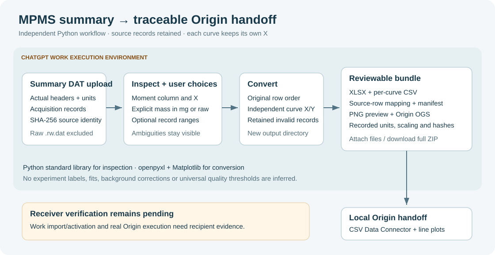

# MPMS 汇总数据 → Origin

[English](README.en.md) · MIT · v0.1.1

面向 **ChatGPT Work 云端**的开源技能：把用户上传的 Quantum Design MPMS **汇总 DAT** 整理为 XLSX、逐曲线 CSV、源行映射、manifest、PNG 预览和 Origin OGS 导入制图脚本。先发现实际表头与单位，再按用户确认的磁矩列、X、质量和段界转换。

**验证状态：本机独立合成检查 47 项通过；ChatGPT Work 接收端导入/启用 pending；Origin 本机执行 pending。** 这是可审阅的源码包，尚未宣称在接收端安装。见[验证记录](skills/mpms-summary-to-origin/references/verification.md)。



## 数据原则

- 样品质量必须由用户明确提供，单位 **mg**；或明确选择 `raw`，保留未归一化磁矩。归一化采用 `moment_emu / (mass_mg / 1000)`，输出 emu/g。
- 实际表头、单位、有限数值数量与多个候选均可检查；磁矩列必须显式指定。不将某代 DC 列设为普遍优先。
- 每条曲线保留自己的 X、原采集顺序和重复点。段界可用源记录范围完整覆盖，不推断 ZFC/FC、升降温或磁滞支路。
- 缺失、NaN 和无穷值保留映射，数值输出留空；原字段保留。原始电压扫描 **`.rw.dat` 不支持**，仅处理汇总数据。
- 不拟合、不扣背景、不按任意质量阈值剔除。输出为可追溯整理结果，实验语义仍需结合测量流程。

## 在 Work 中使用

将本仓库按插件根目录分发，保留 `plugin.json` 和 `skills/`。它采用官方公开的 **Agent Plugins 1.0** 结构，技能目录自动发现；不声明任何本地 Origin 连接。通过接收端当前可用的插件导入/安装入口使用，安装后在新的 Work 对话中确认技能可发现。插件导入功能和公开目录发布流程以接收端为准；上传 ZIP 本身不代表已安装。来源见[公开资料记录](skills/mpms-summary-to-origin/references/sources.md)。

若接收端没有可用插件导入入口，可上传并解压审阅后的源码，按下面方式**手动运行**。这条路径可生成产物，不能标记为已安装或已启用。只提取技能目录时，其自身也带有 `requirements.txt`、全部脚本、引用文档和 `delivery.json` 白名单。

Work 提示词可写：

> 使用 mpms-summary-to-origin 检查我上传的 MPMS 汇总 DAT。先展示实际磁矩候选、单位与分段歧义；由我确认磁矩列和横轴。我会明确提供样品质量（mg）或选择 raw。输出 XLSX、逐曲线 CSV、源行映射、manifest、预览和 Origin OGS 整包。

## 源码手动运行

需要 Python **3.10+**。检查只依赖标准库；转换需要 **openpyxl >=3.1,<4** 与 **Matplotlib >=3.8,<4**。在执行环境安装，不能由用户本机安装替代云端依赖。

```sh
python -m pip install -r requirements.txt
python skills/mpms-summary-to-origin/scripts/mpms.py inspect /path/to/upload.dat --output /path/to/inspection.json
```

按检查结果选择完整表头或从 1 开始的列序号，再替换以下占位符：

```sh
python skills/mpms-summary-to-origin/scripts/mpms.py convert /path/to/upload.dat --output /path/to/new-output --moment-column 'ACTUAL HEADER' --x temperature --mass-mg USER_MASS_MG
```

未归一化模式用 `--raw` 替换 `--mass-mg USER_MASS_MG`。磁场横轴使用 `--x field`，显式横轴使用 `--x-column`。段界覆盖使用 `--segments /path/to/confirmed-segments.json`；从检查结果的 `segment_template` 开始编辑，完整覆盖所有源记录。输出目录必须新建。只提取技能目录时，在该目录运行 `python scripts/mpms.py ...` 并使用该目录内的依赖文件。

详见[中文操作指南](skills/mpms-summary-to-origin/references/zh-CN/workflow.md)与[格式和科学决策](skills/mpms-summary-to-origin/references/zh-CN/format-and-decisions.md)。

## 交付与验收

| 产物 | 用途 |
| --- | --- |
| `magnetometry.xlsx` | 元数据、原字段、曲线索引、逐曲线表和每曲线独立 XY 宽表 |
| `curve_*.csv` | 每条曲线数值与源记录/物理源行 |
| `source_rows.csv`、`manifest.json` | 完整映射、源 SHA-256、选择/换算/段界和产物哈希 |
| `preview.png` | Matplotlib 预览，检查排列与单位 |
| `import_origin.ogs` | 下载后在 Origin 本地导入 CSV 并逐曲线制图 |

接收人解压完整产物后，按 OGS 顶部说明运行 `Main`，将包含末尾反斜杠的 Windows 目录作为参数。OGS 使用 CSV Data Connector；需在实际 Origin 版本中核对数值、缺失点行为和图形。PNG 是预览，不是 Origin 截图；本包不生成原生 `.opju`。

[接收端验收步骤](skills/mpms-summary-to-origin/references/receiver-checklist.md)分别记录 Work 安装/手动执行与 Origin 实跑。分发包不含用户数据、样本 DAT、测试答案或生成结果；合成验证材料仅存在临时验证目录。源码模块分别负责命令行、解析/科学约束、产物导出，架构图为可编辑 [SVG](docs/architecture.svg)。

## 目录

```text
plugin.json
skills/mpms-summary-to-origin/
  SKILL.md
  delivery.json
  requirements.txt
  scripts/       # CLI / parser / exporters
  references/    # bilingual workflow, decisions, sources, verification
docs/architecture.svg
README.md / README.en.md / LICENSE
```

本仓库按 MIT 许可分发。Quantum Design 与 Origin 为相关厂商名称；本项目为独立数据整理工具。
